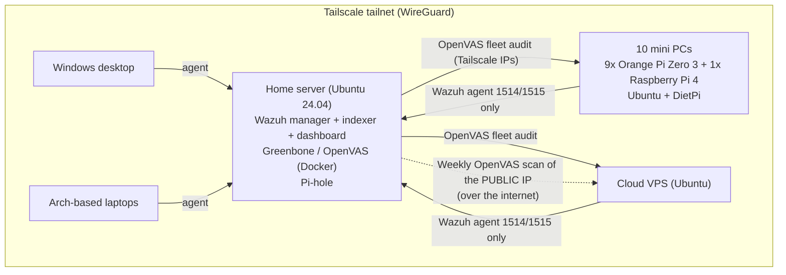

# Homelab SOC: Wazuh SIEM + OpenVAS for an ARM mini-PC fleet, Cloud VPS and Desktops.

Security monitoring for a small fleet of always-on ARM single-board computers (**9 Orange Pi Zero 3 and 1 Raspberry Pi 4**), a home server, desktops and a cloud VPS, all connected over **Tailscale**.

- **Wazuh 4.14** (SIEM / XDR): log collection, file integrity monitoring, rootkit detection, vulnerability detection and custom fleet rules
- **Greenbone / OpenVAS** (vulnerability scanner): weekly internet-side scan of the VPS public IP, plus a one-off audit of the whole fleet over Tailscale

The most valuable outcome was not the setup itself. **Within two days, Wazuh caught a real, previously unnoticed malware implant** on one of the boards. This README focuses on what the two tools found and how each finding was handled.

---

## Architecture



**Monitoring highlights**
- **Logs survive reboots.** The boards keep `/var/log` in RAM, so logs used to vanish on every crash. Agents now read **journald** (warnings, errors, auth, sudo, cron, watchdog events) and ship it off the board immediately.
- **SD-card-friendly scan intervals:** file integrity and inventory every 12h, CIS-style configuration assessment daily, a lighter rootcheck, and real-time file integrity on `.ssh/`, `/etc/profile.d` and `/etc/init.d`.
- **Custom rules** for this fleet:

| Rule | Level | Detects |
|---|---|---|
| 100100–100103 | 3–10 | Network watchdog restarting interfaces, reloading the WiFi driver, or forcing a reboot |
| 100110 | 12 | SD card / ext4 I/O errors (dying cards) |
| 100120 | 10 | Any filesystem at 90%+ |
| 100130–100135 | 3–10 | WiFi disconnects and auth failures; **WiFi flapping** (5+ drops in 10 min) |
| built-in 533 | 7 | A listening TCP port opened or closed |

---

## 🚨 Finding #1: a hidden malware implant, caught by Wazuh rootcheck

### Detection
Two days after deployment, Wazuh raised repeated **level 11 "Possible kernel level rootkit" (rule 521)** and **rule 510** alerts on one Orange Pi, `mini-casa`:

```
Process '1052' hidden from /proc.   (and 1053, 1055, 1056, 23263)
Process '1051' hidden from ps.
```

The same PIDs reappeared at every 12-hour rootcheck run. At first glance that looks like the classic false positive caused by threads. It wasn't.

### Investigation
| Finding | Meaning |
|---|---|
| PIDs 1052+ were **threads** of PID 1051, a root process named `system.mark` (PPID 1) | A real process, started at boot |
| `/proc/1051` returned *No such file or directory* even when opened directly | The thread-group leader was **hidden**. It can't vanish legitimately while its threads are alive |
| `/proc/self/mountinfo` showed `tmpfs` **mounted over `/proc/1051`** | A userland PID-hiding trick: `ps` and `ls` see an empty directory |
| Executable `/usr/lib/system.mark`, command line set to **`[rcu_gp]`** | It disguises itself as a kernel thread |
| `/etc/profile.d/gateway.sh` defines shell functions `ps`, `ss` and `netstat` | Every interactive shell **filters the malware's names out** of these tools' output |
| A second running copy, `/etc/profile.d/bash.cfg`, also posing as `[rcu_gp]` | Redundancy |
| Kernel taint only 1024 (the staging WiFi driver), and no `ld.so.preload` | **No kernel module.** Userland-only persistence |

The hide-list inside `gateway.sh` gave away the rest of the implant:

| Artifact | Type | Purpose |
|---|---|---|
| `/usr/lib/system.mark` | ARM64 ELF | Main binary |
| `/etc/profile.d/bash.cfg` | ARM64 ELF (same hash) | Copy, started at every login |
| `/usr/lib/libgdi.so.0.8.2` | ARM64 ELF (same hash) | Copy disguised as a library |
| `/usr/sbin/netstat.cfg` | ARM64 ELF (same hash) | Copy, started from `/etc/rc.local` |
| `/boot/system.pub`, `/boot/system.pub.bak` | ARM64 ELF (same hash) | Copies disguised as key files |
| `/etc/profile.d/bash.cfg.sh` | shell | Launches `bash.cfg` on login |
| `/etc/profile.d/gateway.sh` (+ `.bad`) | shell | `ps`/`ss`/`netstat` wrappers that hide the implant |
| `/etc/init.d/dns-udp4` | init script | Boot persistence |
| `/lib/system.mark` lines injected into **44 `/etc/init.d/*` scripts** | persistence | Restarts whenever any service starts |
| `/etc/rc.local` (2 lines) | persistence | Runs `netstat.cfg` |
| `/.mod` | 27-byte script | Unpackaged file in `/`, matching the hide-list pattern |

**Timestomping:** all the binaries carried the timestamp `2023-10-31 11:36:04`, the exact build time of the genuine Ubuntu `procps` package (`ps`, `kill`, `sysctl`). An identical, clean `procps` inside a Docker image layer confirmed this. The malware copied the timestamps of real system tools to blend in, so file dates can't tell when it arrived. The first reliable date is a rewrite of `gateway.sh` at a boot on 2026-09-23. The infection vector is unknown. No foreign logins appeared in `wtmp`, but a compromised host's records can't be fully trusted.

### Indicators of compromise
| File | SHA-256 |
|---|---|
| `system.mark` and all 5 ELF copies | `184ed5d18d46304cda1017de0e9ac11c8ef1a25ade37de4c8f4dec4c33824be2` |
| `gateway.sh` / `gateway.sh.bad` | `5a94bf6d46586246aa141fcbe06fc910203df1b0bb66280fc3852ecc062db690` |
| `bash.cfg.sh` | `b08b0d0545730747…` (prefix) |
| `dns-udp4` | `a3f7d4499b03a14f…` (prefix) |
| `/.mod` | `503dffa20530956c…` (prefix) |

Behavioural indicators: a user-space process with cmdline `[rcu_gp]` and a readable `/proc/<pid>/exe`; `tmpfs` mounted on `/proc/<pid>`; shell functions named `ps`/`ss`/`netstat` in `/etc/profile.d/`.

No public match was found for the main hash at the time of writing.

### Remediation
Rebuilding from a fresh image is the safe answer. This board was cleaned in place, in two phases:

1. **Read-only sweep:** brute-forced every PID to find hidden processes; located the implant's files **by name and indicator, not by timestamp**; listed every startup file that referenced it; checked package integrity (`dpkg --verify`), `ld.so.preload`, UID-0 accounts and SSH keys.
2. **Cleanup:** backed up `/etc`, unmounted the `/proc` mask, killed both processes, **quarantined** all files into an archive (nothing deleted outright), unregistered `dns-udp4`, removed **only the injected lines** from the 44 init scripts (each re-validated with `bash -n`), reinstalled `procps`, then re-checked for respawn.

Nothing respawned. Wazuh now watches `/etc/profile.d` and `/etc/init.d` in real time, so any reinfection would alert immediately.

**A mistake worth noting:** the first cleanup approach selected files by the malware's timestamp. Because of the timestomping, it would have quarantined the genuine `ps`, `libprocps` and dpkg database files and broken the system. The read-only sweep caught this before anything was deleted.

---

## Other Wazuh findings

| Alert / symptom | Root cause | Outcome |
|---|---|---|
| Rootcheck *"Files hidden inside `/tmp/RustDesk`"* (level 11) on the home server | A stale **FUSE mount** (RustDesk clipboard transfer): "Transport endpoint is not connected" | **False positive.** Unmounted, plus a level-0 rule for that path |
| Windows agent **disconnected** for 24h | A Windows "debloat" tweak had **disabled the IP Helper service (`iphlpsvc`)**, which Tailscale depends on | Service re-enabled; agent back online |
| Docker container events | Far too noisy on boards running many containers | Collection removed fleet-wide, plus a level-0 rule on group `docker` |

## Finding: Tailscale ACL hole

While restricting agent traffic, I found that a rule granting `autogroup:member` access to the admin machines was far broader than intended. Every device is logged in with the same account, so `autogroup:member` included **all ten boards and the VPS**, giving each of them full access to the server and desktops. A compromised board (like `mini-casa`) could have reached everything.

**Fix:** explicit host lists. Boards and the VPS may reach **only** the Wazuh ports (`1514/1515`) on the server, and nothing else, including each other. ACL `tests` enforce this, so the policy refuses to save if a board can reach SSH, the dashboard or another board.

---

## OpenVAS / Greenbone findings

Scans use "Full and fast" across all TCP ports plus the top 100 UDP ports.

| Scan | Targets | Viewpoint | Frequency |
|---|---|---|---|
| Fleet audit | 10 boards + VPS, Tailscale IPs | What any device on the tailnet can reach | One-off (2 Oct 2026) |
| Public | VPS public IP | What the internet can reach | **Weekly** |

### Fleet audit over Tailscale (2 October 2026, 11 hosts, 2 at a time)

| Severity | Count | Findings |
|---|---|---|
| Critical | **0** | none |
| High | **0** | none |
| Medium | **2** | `mini-casa`: **Pi-hole web root exposes its `.git` folder** on 80/tcp and 443/tcp |
| Low | **23** | TCP timestamps and ICMP timestamp replies (all hosts); weak SSH MACs `umac-64*` (VPS) |

Report filter: QoD ≥ 70, log-level results hidden.

| Finding | Severity | Risk | Status |
|---|---|---|---|
| **Pi-hole web UI exposing `.git`** (`/admin/.git/config`, `HEAD`, `index`, `logs/HEAD`…) on `mini-casa` | Medium (CVSS 5.0) | Leaks the Pi-hole version history, update times and device hostname: reconnaissance data. Found on **the same board that turned out to be compromised**, which also ran far more services (Pi-hole, unbound, openvpn, hostapd, xrdp, cups) than any other board | ✅ Fixed |
| **Weak SSH MAC algorithms** `umac-64-etm@openssh.com`, `umac-64@openssh.com` (VPS) | Low (CVSS 2.6) | 64-bit integrity tags | ✅ Fixed: only strong MACs allowed |
| **TCP / ICMP timestamps** (all hosts) | Low (CVSS 2.1–2.6) | Remote uptime / clock estimation | ✅ Fixed |

Nothing else turned up over Tailscale. The earning-app ports, node exporter and SSH on the boards produced no findings above Low.

### VPS public IP, internet side (weekly)

| Scan | Findings | Notable |
|---|---|---|
| 2 Oct 2026 | 1 Low | SSH (22/tcp) open to the internet **with weak MACs `umac-64*`** |
| 10 Oct 2026 | 1 Low | Only TCP timestamps. SSH still public, **no longer flagged** after the weak MACs were removed |

No Critical, High or Medium issues were found on the public IP in either run.

---

## Lessons learned

1. **Deploy detection early.** The implant had been on the board for weeks, and the crashes I'd blamed on a dying SD card may well have been the malware. Rootcheck found it within two days.
2. **"Probably a false positive" deserves five minutes of checking.** Hidden threads are usually benign. A thread whose leader can't be opened at all never is.
3. **Don't trust file timestamps on a compromised host.** Find malware by indicators, not dates.
4. **Do a read-only sweep before any destructive step.** It saved the system from my own first cleanup attempt.
5. **The scanner and the SIEM tell one story.** The only Medium findings in the fleet were on the board that was already compromised, the one running the most extra services.
6. **`autogroup:member` means *every* device on the account.** Write ACLs against explicit hosts or tags, and add `tests`.
