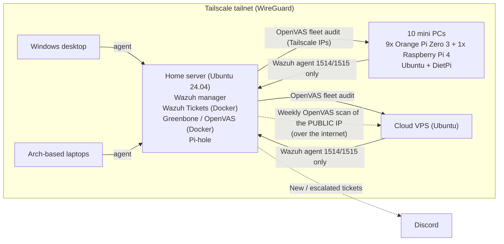
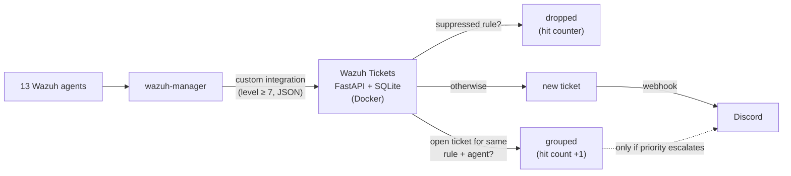

# Homelab SOC: Wazuh SIEM + OpenVAS for an ARM mini-PC fleet, Cloud VPS and Desktops.

Security monitoring for a small fleet of always-on ARM single-board computers (**9 Orange Pi Zero 3 and 1 Raspberry Pi 4**), a home server, desktops and a cloud VPS, all connected over **Tailscale**.

- **Wazuh 4.14** (SIEM / XDR): log collection, file integrity monitoring, rootkit detection, vulnerability detection and custom fleet rules
- **Greenbone / OpenVAS** (vulnerability scanner): weekly internet-side scan of the VPS public IP, plus a one-off audit of the whole fleet over Tailscale
- **Wazuh Tickets** (built for this lab): a self-hosted ticket queue that turns Wazuh alerts into prioritised tickets, keeps a searchable history of every investigation, and pings **Discord** when something new needs attention

The most valuable outcome was not the setup itself. **Within two days, Wazuh caught a real, previously unnoticed malware implant** on one of the boards: a node of the **Kaiji (Chaos) DDoS/proxy botnet**. This README focuses on what the tools found and how each finding was handled.

---

## Architecture



**Monitoring highlights**
- **Logs survive reboots.** The boards keep `/var/log` in RAM, so logs used to vanish on every crash. Agents now read **journald** (warnings, errors, auth, sudo, cron, watchdog events) and ship it off the board immediately.
- **SD-card-friendly scan intervals:** file integrity and inventory every 12h, CIS-style configuration assessment daily, a lighter rootcheck, and real-time file integrity on `.ssh/`, `/etc/profile.d` and `/etc/init.d`.
- **Alerts become tickets.** Everything at level 7+ from all 13 agents lands in a triage queue instead of a dashboard. See [Alert triage: Wazuh Tickets](#alert-triage-wazuh-tickets).
- **Custom rules** for this fleet:

| Rule | Level | Detects |
|---|---|---|
| 100100–100103 | 3–10 | Network watchdog restarting interfaces, reloading the WiFi driver, or forcing a reboot |
| 100110 | 12 | SD card / ext4 I/O errors (dying cards) |
| 100120 | 10 | Any filesystem at 90%+ |
| 100121 | 0 | Child of 100120: ignores read-only snap `squashfs` loop mounts, which always report 100% |
| 100130–100135 | 3–10 | WiFi disconnects and auth failures; **WiFi flapping** (5+ drops in 10 min) |
| built-in 533 | 7 | A listening TCP port opened or closed |

---

## 🚨 Finding #1: a hidden malware implant, caught by Wazuh rootcheck

### Detection
Two days after deployment, Wazuh raised repeated **level 11 "Possible kernel level rootkit" (rule 521)** and **rule 510** alerts on one Orange Pi, `mini-casa`:

```
Process '1052' hidden from /proc.   (and 1053, 1055, 1056, 23263)
Process '1051' hidden from ps.
```

The same PIDs reappeared at every 12-hour rootcheck run. At first glance that looks like the classic false positive caused by threads. It wasn't.

### Investigation
| Finding | Meaning |
|---|---|
| PIDs 1052+ were **threads** of PID 1051, a root process named `system.mark` (PPID 1) | A real process, started at boot |
| `/proc/1051` returned *No such file or directory* even when opened directly | The thread-group leader was **hidden**. It can't vanish legitimately while its threads are alive |
| `/proc/self/mountinfo` showed `tmpfs` **mounted over `/proc/1051`** | A userland PID-hiding trick: `ps` and `ls` see an empty directory |
| Executable `/usr/lib/system.mark`, command line set to **`[rcu_gp]`** | It disguises itself as a kernel thread |
| `/etc/profile.d/gateway.sh` defines shell functions `ps`, `ss` and `netstat` | Every interactive shell **filters the malware's names out** of these tools' output |
| A second running copy, `/etc/profile.d/bash.cfg`, also posing as `[rcu_gp]` | Redundancy |
| Kernel taint only 1024 (the staging WiFi driver), and no `ld.so.preload` | **No kernel module.** Userland-only persistence |

The hide-list inside `gateway.sh` gave away the rest of the implant:

| Artifact | Type | Purpose |
|---|---|---|
| `/usr/lib/system.mark` | ARM64 ELF | Main binary |
| `/etc/profile.d/bash.cfg` | ARM64 ELF (same hash) | Copy, started at every login |
| `/usr/lib/libgdi.so.0.8.2` | ARM64 ELF (same hash) | Copy disguised as a library |
| `/usr/sbin/netstat.cfg` | ARM64 ELF (same hash) | Copy, started from `/etc/rc.local` |
| `/boot/system.pub`, `/boot/system.pub.bak` | ARM64 ELF (same hash) | Copies disguised as key files |
| `/etc/profile.d/bash.cfg.sh` | shell | Launches `bash.cfg` on login |
| `/etc/profile.d/gateway.sh` (+ `.bad`) | shell | `ps`/`ss`/`netstat` wrappers that hide the implant |
| `/etc/init.d/dns-udp4` | init script | Boot persistence |
| `/lib/system.mark` lines injected into **44 `/etc/init.d/*` scripts** | persistence | Restarts whenever any service starts |
| `/etc/rc.local` (2 lines) | persistence | Runs `netstat.cfg` |
| `/.mod` | 27-byte script | Unpackaged file in `/`, matching the hide-list pattern |

**Timestomping:** all the binaries carried the timestamp `2023-10-31 11:36:04`, the exact build time of the genuine Ubuntu `procps` package (`ps`, `kill`, `sysctl`). An identical, clean `procps` inside a Docker image layer confirmed this. The malware copied the timestamps of real system tools to blend in, so file dates can't tell when it arrived. The first reliable date is a rewrite of `gateway.sh` at a boot on 2026-09-23.

### Identification: Kaiji / Chaos botnet
The file hash had no public match, but the artifact set is a fingerprint. `/usr/lib/libgdi.so.0.8.2`, `/boot/system.pub`, `/etc/init.d/dns-udp4`, `/.mod`, `/etc/profile.d/bash.cfg(.sh)`, `gateway.sh` and `system.mark` match published analyses of **Kaiji**, a Go-based Linux botnet (recent builds are also tracked as **Chaos**), file for file. This sample was an ARM64 build.

**What it was for.** Kaiji turns the machines it infects into remotely controlled bots. It has two jobs:
- **DDoS for hire.** More than 24 attack methods (TCP, UDP, TLS and WebSocket floods, raw packets). The board was one of many machines whose bandwidth was used to knock targets offline.
- **Proxy node.** An embedded SOCKS5/HTTP proxy that relays other people's traffic, so their activity appears to come from a residential home IP.

It is not built to steal data. Its value to the attacker is the board's CPU, bandwidth and clean IP address. That workload is a likely explanation for the instability and memory pressure `mini-casa` had shown for weeks.

**How it behaved.**

| Tactic | What it did |
|---|---|
| **Persistence and redundancy** | 6 identical copies, each started independently: an init script (`dns-udp4`), `rc.local`, a login hook (`bash.cfg.sh`), `/.mod`, and lines injected into 44 `/etc/init.d` scripts so that starting almost any service relaunched it. Removing one copy achieved nothing. Another copy would bring it back. |
| **Disguise** | Process name set to `[rcu_gp]`, which looks like a kernel thread. Copies named like a library (`libgdi.so`), key files (`system.pub`) or config files (`netstat.cfg`, `bash.cfg`). |
| **Concealment** | A `tmpfs` mounted over its own `/proc/<pid>` so tools reading `/proc` saw an empty directory, plus `ps`/`ss`/`netstat` shell wrappers in `/etc/profile.d` that removed its names from the output. |
| **Anti-forensics** | Timestamps copied from the genuine `procps` package, so file dates were useless for finding or dating it. |

No kernel module was involved (user-space only), and no C2 connection was active at inspection time. Kaiji's command channel is mostly idle between orders.

The concealment is what gave it away. It hid its main process but not that process's threads, and Wazuh rootcheck flagged that inconsistency.

### Indicators of compromise
| File | SHA-256 |
|---|---|
| `system.mark` and all 5 ELF copies | `184ed5d18d46304cda1017de0e9ac11c8ef1a25ade37de4c8f4dec4c33824be2` |
| `gateway.sh` / `gateway.sh.bad` | `5a94bf6d46586246aa141fcbe06fc910203df1b0bb66280fc3852ecc062db690` |
| `bash.cfg.sh` | `b08b0d054573074796646937fe25499e9bd83a537fc94221c0c07702de618931` |
| `dns-udp4` | `a3f7d4499b03a14ff2de76122b6a61c221151f59daa6a63a78ae5a805c95a482` |
| `/.mod` | `503dffa20530956c5f61187e00935f20fe508c35dbb1fcf665b5d28d07d3d704` |

Behavioural indicators: a user-space process with cmdline `[rcu_gp]` and a readable `/proc/<pid>/exe`; `tmpfs` mounted on `/proc/<pid>`; shell functions named `ps`/`ss`/`netstat` in `/etc/profile.d/`.

When first investigated, the main hash had no public match, so the family was identified from the file paths and behaviour (see above). The quarantined samples were later **submitted to VirusTotal**, where `system.mark` (`184ed5d1…24be2`) is detected by **31 engines**. A community comment there documents the paths, persistence and evasion techniques above.

🔗 [VirusTotal report](https://www.virustotal.com/gui/file/184ed5d18d46304cda1017de0e9ac11c8ef1a25ade37de4c8f4dec4c33824be2)

### Remediation
The board was **formatted and reinstalled from a fresh image**. A compromised system can't be trusted after cleaning, so nothing from the old install was kept. Wazuh now also watches `/etc/profile.d` and `/etc/init.d` in real time, so any reinfection on any board would alert immediately.

---

## Alert triage: Wazuh Tickets

With 13 agents, the Wazuh dashboard fills up with routine events: file checksum changes, compliance results, port changes, scanner noise. It is good for exploring data but bad at answering *"what do I need to look at right now, and what did I already check?"* The Kaiji alert showed that the one alert that matters can look exactly like a routine false positive.

So I built **Wazuh Tickets**, a small self-hosted ticketing app that sits next to the Wazuh manager and turns alerts into a work queue.

### How it works



- **Ingestion.** A Wazuh `custom-` integration (a short Python script that uses only the standard library and runs on Wazuh's bundled interpreter) POSTs every alert at level 7 or higher to the app, authenticated with a bearer token.
- **Grouping.** Repeat alerts for the same **rule + agent** fold into the one open ticket and increment its hit counter. Brute-force bursts and noisy rules create one ticket, not hundreds.
- **Priority** comes from the rule level: 12+ critical, 10–11 high, 7–9 medium. The queue is sorted by priority. If a higher-level alert lands on an open ticket, it is **escalated** and Discord is notified again.
- **Discord.** Each new ticket posts an embed coloured by priority, with agent, rule, MITRE technique and a link to the ticket. Critical tickets can @mention me.

### Features

| Area | What it does |
|---|---|
| **Queue** | Open tickets sorted by priority, with "start working", bulk-close and live counters per priority |
| **Investigation** | Each ticket shows the agent, rule, MITRE mapping, the last 100 raw events with their logs, the full alert JSON, and links to earlier tickets for the same rule and agent |
| **Indicators** | IPs, users, files, commands and hashes are extracted from the alerts automatically. Each one links to a search across all tickets, and public IPs and hashes get AbuseIPDB / VirusTotal links |
| **Search** | Searches titles, notes **and the raw alert JSON**, so an IP, username, file path or hash finds every ticket it ever appeared in. Matches are highlighted and listed first |
| **Closing** | Resolution (Resolved / False positive / Duplicate / Accepted risk) plus a note on what was found and done, so the history doubles as an investigation log |
| **Suppression** | Optional when closing: mute the rule on that agent or everywhere, for 24h / 7d / 30d / forever. Dropped alerts are still counted, and suppressions can be removed at any time |
| **History & export** | Closed tickets filterable by period, resolution, agent and priority, with time-to-close and CSV export |
| **Insights** | Tickets per day, noisiest rules with their false-positive rate, tickets per agent, storage use |
| **Homepage widget** | A read-only `/api/stats` endpoint feeds live open-ticket counts into the lab's Homepage dashboard |

**Footprint:** one container (145 MB image) and a SQLite file of a few MB. At most 100 raw alerts are kept per ticket, and tickets closed more than 90 days ago are trimmed to a single sample alert. Tickets and notes are kept forever.

### The first days

Within about **36 hours** of going live, the queue had absorbed **461 alerts from 13 agents into 44 tickets** (roughly 10 alerts per ticket). Every one was triaged and closed: about **70% as false positives**, the rest as accepted risk or resolved. That noise is exactly what used to bury real findings, and working through it drove a round of tuning:

| Ticket | Root cause | Outcome |
|---|---|---|
| **Filesystem at 90%+** (custom rule 100120) on the VPS, 22 hits | Every hit was a **snap `squashfs` loop mount** (`/snap/core22`, `/snap/certbot`…). These are read-only images and always report 100%. The real disk was at 61% | **False positive.** Level-0 child rule **100121** matches `/dev/loopN … /snap/` only, so real disks still alert fleet-wide. No snap alerts since |
| **sshd: possible attack** (rule 5701) on the VPS | Internet scanners sending `GET /` and `GET /favicon.ico` to port 22 to fingerprint the service. No login attempts | **False positive.** It prompted a review of the VPS's SSH exposure: root login disabled, fail2ban and ufw active |
| **Listened ports changed** (rule 533) on the home server | The diff was exactly the new ticket app's own port | **Resolved.** The rule is deliberately kept: a new unknown listener is a classic backdoor signal |
| **CIS benchmark score below 50%** (rule 19004) | Summary of the daily configuration assessment. Not an incident, and it re-fires on every scan | **Accepted risk**, suppressed. Individual failed checks still raise their own tickets |
| **SCA: "sshd MACs" passed → failed** (rule 19011) | `sshd_config` was untouched. The flip followed an automatic `openssh-server` update | Not an incident. SSH on the home server is only reachable from the LAN and the tailnet |
| **File integrity: checksum changed / file deleted** (rules 550 / 553) | Routine changes from legitimate software on the boards: EarnApp, CUPS and Navidrome updating their own files | **False positive** |

### Why build it instead of using an existing tool?

Full platforms such as TheHive or DFIR-IRIS do far more, but they are heavy for a homelab and assume a team. The goal here was narrower: **one person, one queue, nothing lost.** The integration script is about 20 lines and the app is a single FastAPI service with SQLite, so it fits on the same box as the Wazuh manager. The core idea (group by rule + agent, prioritise by level, record why each ticket was closed) is what makes the noise manageable.

---

## Other Wazuh findings

| Alert / symptom | Root cause | Outcome |
|---|---|---|
| Rootcheck *"Files hidden inside `/tmp/RustDesk`"* (level 11) on the home server | A stale **FUSE mount** (RustDesk clipboard transfer): "Transport endpoint is not connected" | **False positive.** Unmounted, plus a level-0 rule for that path |
| Windows agent **disconnected** for 24h | A Windows "debloat" tweak had **disabled the IP Helper service (`iphlpsvc`)**, which Tailscale depends on | Service re-enabled; agent back online |
| Docker container events | Far too noisy on boards running many containers | Collection removed fleet-wide, plus a level-0 rule on group `docker` |
| *"Filesystem at 90%+"* on the VPS | Read-only snap `squashfs` mounts always report 100% | **False positive.** Level-0 child rule 100121 for snap loop mounts only |

---

## OpenVAS / Greenbone findings

Scans use "Full and fast" across all TCP ports plus the top 100 UDP ports.

The full reports are in [`reports/`](reports/), redacted: IP addresses are replaced with host labels (`mini-01`…`mini-10`, `mini-casa`, `vps`, `vps-public`), the VPS domain is removed, and the Pi-hole `.git` log excerpt is blacked out.

| Scan | Targets | Viewpoint | Frequency |
|---|---|---|---|
| Fleet audit | 10 boards + VPS, Tailscale IPs | What any device on the tailnet can reach | One-off (2 Oct 2026) |
| Public | VPS public IP | What the internet can reach | **Weekly** |

### Fleet audit over Tailscale (2 October 2026, 11 hosts, 2 at a time)

| Severity | Count | Findings |
|---|---|---|
| Critical | **0** | none |
| High | **0** | none |
| Medium | **2** | `mini-casa`: **Pi-hole web root exposes its `.git` folder** on 80/tcp and 443/tcp |
| Low | **23** | TCP timestamps and ICMP timestamp replies (all hosts); weak SSH MACs `umac-64*` (VPS) |

Report filter: QoD ≥ 70, log-level results hidden.

| Finding | Severity | Risk | Status |
|---|---|---|---|
| **Pi-hole web UI exposing `.git`** (`/admin/.git/config`, `HEAD`, `index`, `logs/HEAD`…) on `mini-casa` | Medium (CVSS 5.0) | Leaks the Pi-hole version history, update times and device hostname: reconnaissance data. Found on **the same board that turned out to be compromised**, which also ran far more services (Pi-hole, unbound, openvpn, hostapd, xrdp, cups) than any other board | ✅ Fixed |
| **Weak SSH MAC algorithms** `umac-64-etm@openssh.com`, `umac-64@openssh.com` (VPS) | Low (CVSS 2.6) | 64-bit integrity tags | ✅ Fixed: only strong MACs allowed |
| **TCP / ICMP timestamps** (all hosts) | Low (CVSS 2.1–2.6) | Remote uptime / clock estimation | ✅ Fixed |

Nothing else turned up over Tailscale. The services and SSH on the boards produced no findings above Low.

### VPS public IP, internet side (weekly)

| Scan | Findings | Notable |
|---|---|---|
| 2 Oct 2026 | 1 Low | SSH (22/tcp) open to the internet **with weak MACs `umac-64*`** |
| 10 Oct 2026 | 1 Low | Only TCP timestamps. SSH still public, **no longer flagged** after the weak MACs were removed |

No Critical, High or Medium issues were found on the public IP in either run.

### The vulnerabilities explained

**Pi-hole `.git` folder exposed (Medium).** The Pi-hole web root served its own `.git` directory over HTTP and HTTPS. Anyone who could reach the board could download the repository metadata: version history, update times and the hostname. This isn't a way in by itself. It is reconnaissance: an attacker learns the exact software version and can match it to known exploits. *Fix:* access to `.git` is blocked, and the board itself has since been rebuilt.

**Weak SSH MAC algorithms on the VPS (Low).** SSH protects every packet with a MAC, a short tag that proves the packet wasn't altered. `umac-64` produces 64-bit tags, which are short by modern standards and in theory easier to forge. The practical risk is small, but this SSH port faces the whole internet, so it was worth hardening. *Fix:* only strong MACs are offered now (`hmac-sha2-256/512-etm`, `umac-128-etm`). The next public scan no longer flagged it.

**TCP and ICMP timestamps (Low, all hosts).** Hosts answered ICMP timestamp requests, and TCP packets carried a running timestamp counter. Together they let anyone estimate a machine's clock and uptime. Long uptime is a hint that kernel patches haven't been applied, and the data also helps fingerprint hosts. *Fix:* ICMP timestamp replies are dropped and TCP timestamps are disabled where the scanner flagged them.

### Hardening: automatic security updates
Nothing on the boards or the server was installing security updates on its own. Unpatched, always-on devices are what botnets like Kaiji look for. All ten boards and the home server now run **weekly unattended security upgrades** on a Sunday schedule. On DietPi this meant unmasking the APT timers that DietPi disables by default and repairing interrupted `dpkg` states. Each upgrade runs as a detached job, so an upgrade of Tailscale itself can't cut the session off mid-update.

---

## Lessons learned

1. **Deploy detection early.** The implant had been on the board for weeks, and the crashes I'd blamed on a dying SD card may well have been the malware. Rootcheck found it within two days.
2. **"Probably a false positive" deserves five minutes of checking.** Hidden threads are usually benign. A thread whose leader can't be opened at all never is.
3. **Don't trust file timestamps on a compromised host.** Find malware by indicators, not dates.
4. **The scanner and the SIEM tell one story.** The only Medium findings in the fleet were on the board that was already compromised, the one running the most extra services.
5. **Stealth creates its own signals.** Kaiji's hiding tricks (a mount over `/proc`, a fake kernel-thread name, shell-function wrappers) are exactly the kind of anomalies a host-based detector is designed to notice.
6. **Detection is only half the job. Triage is the bottleneck.** A SIEM that produces hundreds of alerts a day hides the one that matters. Grouping repeats, sorting by priority and writing down *why* each alert was dismissed turned a noisy dashboard into a queue that gets emptied, and every false positive closed became a tuning rule instead of a recurring distraction.
